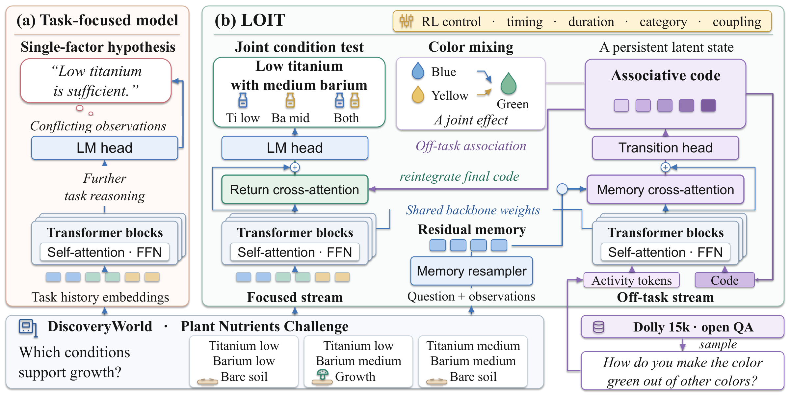

# When to Incubate: Learning Off-Task Associations for Scientific Ideation

Open-source code for the paper.

Scientific ideation requires unexpected associations, yet large language model agents often revisit familiar hypotheses as observations become scarce. LOIT preserves focused reasoning and encodes the question and observations as residual memory. During incubation, a separate Transformer stream processes off-task activities and evolves associative codes through memory-guided transitions and stochastic topic changes. Return attention integrates the final code into screened proposals, while a reinforcement learning controller selects incubation actions using predicted gain and cost.

[](assets/overview.pdf)

Task-focused reasoning and LOIT on DiscoveryWorld's Plant Nutrients Challenge.

## Installation

Python 3.10 or later.

```bash
pip install -e ".[models,data,test]"
```

## Usage

Prepare scientific records and the activity pool as described in [Execution and inputs](docs/execution.md).

```bash
python -m loit train --config configs/qwen3_8b.yaml --stage focused \
  --records data/scientific_training.jsonl --output checkpoints/focused

python -m loit propose --config configs/qwen3_8b.yaml \
  --checkpoint checkpoints/controller --calibration data/calibration.json \
  --tasks data/tasks.jsonl --activities data/activities.jsonl \
  --output results/proposals.jsonl
```

Configurations cover Qwen3-8B, Llama-3.1-8B-Instruct, and DeepSeek-R1-Distill-Qwen-7B. The execution guide describes module initialization, association learning, return refinement, paired utility estimation, controller optimization, development calibration, and benchmark interfaces. Command options are available through `python -m loit --help`.

## Software checks

```bash
pytest -q -p no:cacheprovider
```

The code is distributed under the [MIT License](LICENSE). The displayed figure is from the paper.
