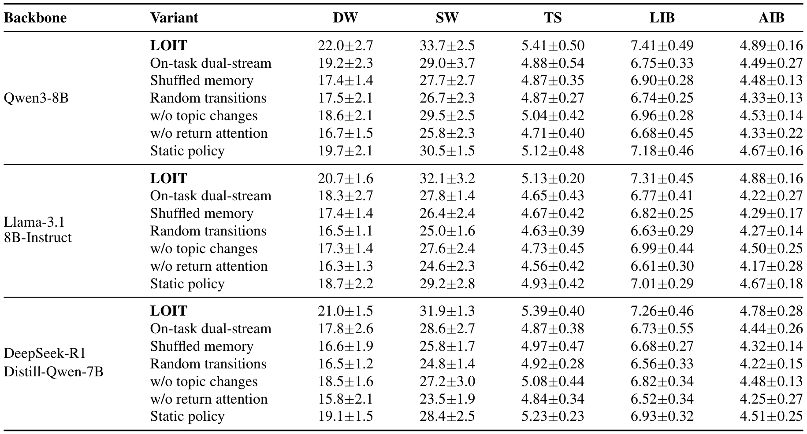
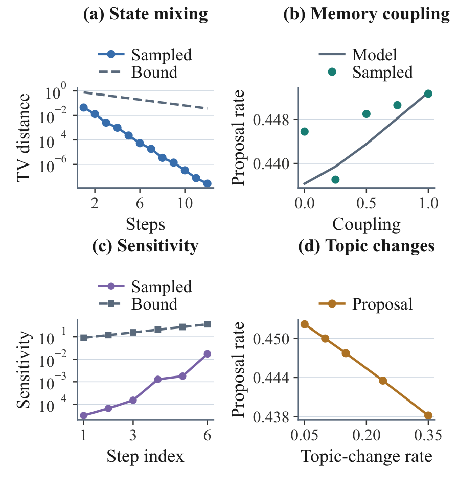

# When to Incubate: Learning Off-Task Associations for Scientific Ideation

Scientific ideation requires unexpected associations, yet large language model
agents often revisit familiar hypotheses as observations become scarce.
Cognitive incubation suggests that unrelated activities may facilitate new
connections upon returning to a problem. Inspired by this process, we introduce
the Learned Off-Task Incubation Transformer (LOIT), which learns when to
incubate during scientific exploration. Specifically, LOIT preserves focused
reasoning and encodes the question and observations as residual memory. During
incubation, a separate Transformer stream processes off-task activities and
evolves associative codes through memory-guided transitions and stochastic topic
changes. Return attention then integrates the final code into screened
proposals, while a reinforcement learning controller selects incubation actions
using predicted gain and cost. To understand how incubation affects proposal
quality, we model associative dynamics as a finite-state Markov process and
derive a convergence bound and a sufficient condition for improvement. Across
five benchmarks and three backbones, LOIT achieves the highest mean score in all
15 settings, including matched controls. For example, on Qwen3-8B,
DiscoveryWorld normalized score improves from 13.0% to 22.0%, and ScienceWorld
reward from 19.2% to 33.7%.

## Algorithm Flow

Scientific ideation can stall when continued reasoning revisits familiar hypotheses. Inspired by cognitive incubation, LOIT temporarily shifts computation to unrelated activities while preserving scientific evidence.

[](assets/overview.pdf)

**Figure 1.** Task-focused reasoning and LOIT on DiscoveryWorld’s Plant Nutrients Challenge. In seed 1, growth requires low titanium together with medium barium. The three observations challenge a single-factor explanation. A color-mixing instruction from Dolly 15k provides the off-task input. Memory cross-attention retains the scientific observations, the transition head updates an associative code, and return cross-attention carries this code into a proposal for separate and joint nutrient tests.


## Results

### Main Results

**Table 1.** Main results on five public benchmarks, reported as mean ± standard deviation over five seeds. DW reports the released normalized score and SW the released normalized reward, both in percent, TS a 0–12 rubric, LIB v2 native fluency, and AIB the Active critic score.


### Ablation Study

**Table 2.** Component ablations across three backbones, with mean ± standard deviation over five seeds. On-task computation and component removals are retrained; memory, transition, and policy interventions retain weights.



**Memory, learned transitions, and reintegration contribute at distinct stages.** Shuffled memory replaces the question’s memory with an independent donor; randomized transitions sample from the code marginal. Removing topic changes sets their rate to zero during training, while removing return attention retrains the model without that connection. On Qwen3-8B, these variants score 27.7, 26.7, 29.5, and 25.8 on ScienceWorld, compared with 33.7 for LOIT. The retrained on-task variant reaches 29.0. These comparisons distinguish activity type from the stages that ground, develop, and return associations. The larger reduction after removing return attention highlights the role of reintegration in subsequent scientific decisions.

### Analysis



**Figure 2.** Finite-state analysis. (a) State mixing and its bound. (b) Proposal probability by memory coupling. (c) Step-specific sensitivity. (d) Proposal probability by topic-change rate.

**Mixing speed and useful-proposal mass capture different effects.** Panel (b) shows higher useful-proposal probability with stronger memory coupling, consistent with scientific evidence guiding associative transitions. Panel (d) shows lower useful-proposal probability with more frequent topic changes, despite the tighter mixing bound. Consequently, duration and topic changes balance state exploration with the scientific value of the resulting distribution.

## Getting Started

### Environment Setup

```bash
conda create -n loit python=3.10 -y
conda activate loit
pip install -e '.[models,data]'
```

### Data Preparation

Prepare the scientific tasks and verified training records under `data/` using the
[record formats](docs/execution.md#scientific-records). The training commands below
use a separate input file for each stage. Build the off-task activity pool:

```bash
python -m loit prepare-activities --output data/activities.jsonl \
  --manifest data/activities_manifest.json
```

## Training

Train the focused model, initialize the added modules, and continue through
association, return, utility, and controller training:

```bash
python -m loit train --config configs/qwen3_8b.yaml --stage focused \
  --records data/scientific_training.jsonl --output checkpoints/focused

python -m loit train --config configs/qwen3_8b.yaml --checkpoint checkpoints/focused \
  --stage initialize --records data/initialization.jsonl --output checkpoints/initialized

python -m loit train --config configs/qwen3_8b.yaml --checkpoint checkpoints/initialized \
  --stage association --records data/verified_associations.jsonl --output checkpoints/association

python -m loit train --config configs/qwen3_8b.yaml --checkpoint checkpoints/association \
  --stage return --records data/verified_returns.jsonl --output checkpoints/return

python -m loit train --config configs/qwen3_8b.yaml --checkpoint checkpoints/return \
  --stage utility --records data/paired_training.jsonl --output checkpoints/utility

python -m loit train --config configs/qwen3_8b.yaml --checkpoint checkpoints/utility \
  --stage controller --records data/verified_episodes.jsonl --output checkpoints/controller
```

## Evaluation

Calibrate proposal thresholds on development records:

```bash
python -m loit calibrate --config configs/qwen3_8b.yaml \
  --checkpoint checkpoints/controller --gate-records data/gate_development.jsonl \
  --paired-records data/paired_development.jsonl --output data/calibration.json
```

Generate proposals and run interactive tasks with the trained controller:

```bash
python -m loit propose --config configs/qwen3_8b.yaml \
  --checkpoint checkpoints/controller --calibration data/calibration.json \
  --tasks data/tasks.jsonl --activities data/activities.jsonl \
  --output results/proposals.jsonl

python -m loit run --config configs/qwen3_8b.yaml \
  --checkpoint checkpoints/controller --calibration data/calibration.json \
  --tasks data/interactive_tasks.jsonl --activities data/activities.jsonl \
  --environments data/environments.json --output results/episodes.jsonl
```

Configure the interactive environments and apply the benchmark scoring tools
following the [evaluation guide](docs/execution.md#environment-integration).

## License

[MIT License](LICENSE).
