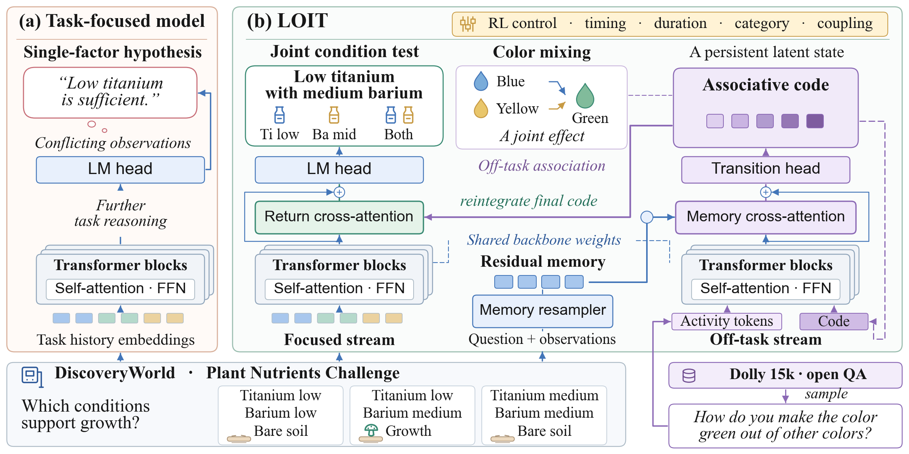
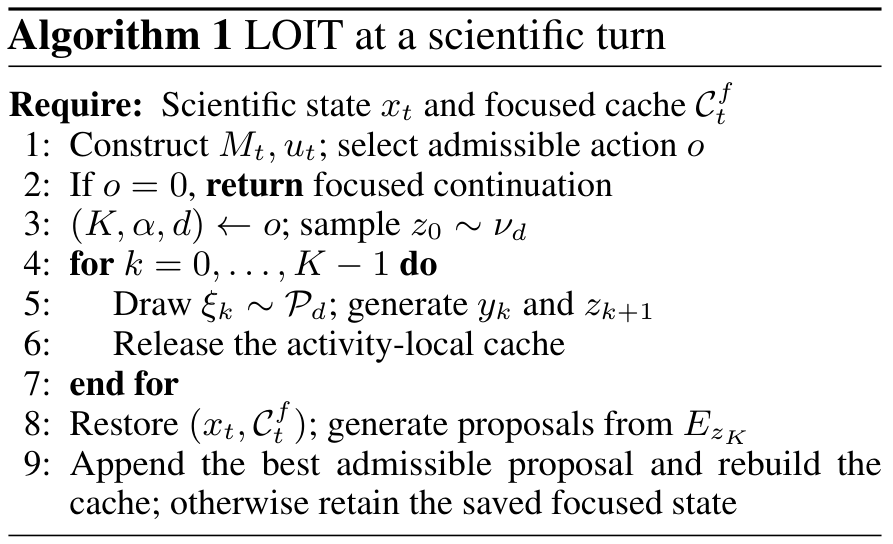
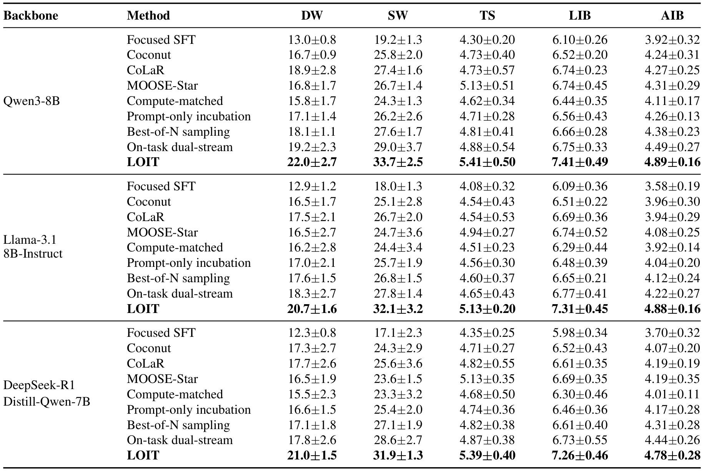

# When to Incubate: Learning Off-Task Associations for Scientific Ideation

Scientific ideation requires unexpected associations, yet large language model
agents often revisit familiar hypotheses as observations become scarce.
Cognitive incubation suggests that unrelated activities may facilitate new
connections upon returning to a problem. Inspired by this process, we introduce
the Learned Off-Task Incubation Transformer (LOIT), which learns when to
incubate during scientific exploration. Specifically, LOIT preserves focused
reasoning and encodes the question and observations as residual memory. During
incubation, a separate Transformer stream processes off-task activities and
evolves associative codes through memory-guided transitions and stochastic topic
changes. Return attention then integrates the final code into screened
proposals, while a reinforcement learning controller selects incubation actions
using predicted gain and cost. To understand how incubation affects proposal
quality, we model associative dynamics as a finite-state Markov process and
derive a convergence bound and a sufficient condition for improvement. Across
five benchmarks and three backbones, LOIT achieves the highest mean score in all
15 settings, including matched controls. For example, on Qwen3-8B,
DiscoveryWorld normalized score improves from 13.0% to 22.0%, and ScienceWorld
reward from 19.2% to 33.7%.

## Algorithm Flow

[](assets/overview.pdf)

**Figure 1.** Task-focused reasoning and LOIT on DiscoveryWorld’s Plant Nutrients Challenge. In seed 1, growth requires low titanium together with medium barium. The three observations challenge a single-factor explanation. A color-mixing instruction from Dolly 15k provides the off-task input. Memory cross-attention retains the scientific observations, the transition head updates an associative code, and return cross-attention carries this code into a proposal for separate and joint nutrient tests.

Scientific ideation can stall when continued reasoning revisits familiar
hypotheses. Inspired by cognitive incubation, LOIT temporarily shifts
computation to unrelated activities while preserving scientific evidence. First,
residual memory conditions the associative transitions. Next, return attention
converts the terminal state into a testable proposal. Finally, a learned
controller allocates incubation according to expected scientific gain and cost.

1. **Associative transitions.** During incubation, a separate Transformer stream processes unrelated activities while attending to residual memory. Learned transitions and stochastic topic changes then evolve persistent associative codes. Memory supplies cross-attention keys and values; off-task states supply queries. Releasing the activity-local cache leaves the code as the persistent state.

2. **Insight Reintegration.** Upon returning, cross-attention reintegrates the final code into focused reasoning, where an evidence gate screens hypotheses and discriminating tests. The highest-scoring admissible proposal enters the history, and the focused cache is rebuilt. An empty admissible set restores the saved history and cache.

3. **Policy optimization and execution.** A learned controller selects incubation timing, duration, activity category, and memory coupling. Paired scientific gains and computation costs guide controller training. At deployment, focused continuation and incubation actions with predicted utility above a validation-selected margin $`m_v\geq0`$ are admissible. The actor selects its highest-probability admissible action, with ties favoring focused continuation. The utility estimator therefore determines admissibility, while the actor supplies learned action preferences.



## Results

### Main Results

**Table 1.** Main results on five public benchmarks, reported as mean ± standard deviation over five seeds. DW reports the released normalized score and SW the released normalized reward, both in percent, TS a 0–12 rubric, LIB v2 native fluency, and AIB the Active critic score.



**LOIT improves both interactive discovery and scientific ideation.** Relative to focused SFT, ScienceWorld reward increases by 14.5, 14.1, and 14.8 points across the three backbones. The DiscoveryWorld normalized score improves by 9.0, 7.8, and 8.7 points. Gains also extend to the three proposal-generation benchmarks. These gains suggest that returned associations support hypothesis generation and subsequent experiment selection.

**MOOSE-Star remains competitive on hypothesis composition.** MOOSE-Star reaches 5.13 on TOMATO-Star with Qwen3-8B and DeepSeek, compared with LOIT’s 5.41 and 5.39. Its performance on hypothesis composition is consistent with its scientific training objective. LOIT also improves the interactive scores, where a proposal guides evidence collection over subsequent actions. The comparison therefore highlights the role of connecting associative exploration to executable tests across task formats.

## Getting Started

### Environment Setup

```bash
conda create -n loit python=3.10 -y
conda activate loit
pip install -e '.[models,data]'
```

### Data Preparation

The experiments use [DiscoveryWorld](https://github.com/allenai/discoveryworld),
[ScienceWorld](https://github.com/allenai/ScienceWorld),
[TOMATO-Star](https://github.com/ZonglinY/MOOSE-Star),
[LiveIdeaBench v2](https://github.com/x66ccff/liveideabench), and
[AgentIdeaBench](https://github.com/HKUST-KnowComp/AgentIdeaBench).

Prepare the permitted scientific tasks and independently verified training
records using the [record formats](docs/execution.md#scientific-records).
Keep model-dependent rollouts and labels under `data/<model>/`. Build the shared
off-task activity pool:

```bash
python -m loit prepare-activities --output data/activities.jsonl \
  --manifest data/activities_manifest.json
```

## Training

Select a backbone:

- **Qwen3-8B**: `MODEL=qwen3_8b`
- **Llama-3.1-8B-Instruct**: `MODEL=llama_3_1_8b`
- **DeepSeek-R1-Distill-Qwen-7B**: `MODEL=deepseek_r1_qwen_7b`

Train the focused model, initialize the added modules, and continue through
association, return, utility, and controller training:

```bash
python -m loit train --config "configs/${MODEL}.yaml" --stage focused \
  --records data/scientific_training.jsonl --output "checkpoints/${MODEL}/focused"

python -m loit train --config "configs/${MODEL}.yaml" --checkpoint "checkpoints/${MODEL}/focused" \
  --stage initialize --records "data/${MODEL}/initialization.jsonl" --output "checkpoints/${MODEL}/initialized"

python -m loit train --config "configs/${MODEL}.yaml" --checkpoint "checkpoints/${MODEL}/initialized" \
  --stage association --records "data/${MODEL}/verified_associations.jsonl" --output "checkpoints/${MODEL}/association"

python -m loit train --config "configs/${MODEL}.yaml" --checkpoint "checkpoints/${MODEL}/association" \
  --stage return --records "data/${MODEL}/verified_returns.jsonl" --output "checkpoints/${MODEL}/return"

python -m loit train --config "configs/${MODEL}.yaml" --checkpoint "checkpoints/${MODEL}/return" \
  --stage utility --records "data/${MODEL}/paired_training.jsonl" --output "checkpoints/${MODEL}/utility"

python -m loit train --config "configs/${MODEL}.yaml" --checkpoint "checkpoints/${MODEL}/utility" \
  --stage controller --records "data/${MODEL}/verified_episodes.jsonl" --output "checkpoints/${MODEL}/controller"
```

Add `--resume` to the same command to continue interrupted training. For
distributed training, replace `python -m loit` with
`accelerate launch --config_file configs/fsdp.yaml -m loit`.

## Evaluation

Calibrate proposal thresholds on development records:

```bash
python -m loit calibrate --config "configs/${MODEL}.yaml" \
  --checkpoint "checkpoints/${MODEL}/controller" --gate-records "data/${MODEL}/gate_development.jsonl" \
  --paired-records "data/${MODEL}/paired_development.jsonl" --output "data/${MODEL}/calibration.json"
```

Generate proposals and run interactive tasks with the trained controller:

```bash
python -m loit propose --config "configs/${MODEL}.yaml" \
  --checkpoint "checkpoints/${MODEL}/controller" --calibration "data/${MODEL}/calibration.json" \
  --tasks data/tasks.jsonl --activities data/activities.jsonl \
  --output "results/${MODEL}/proposals.jsonl"

python -m loit run --config "configs/${MODEL}.yaml" \
  --checkpoint "checkpoints/${MODEL}/controller" --calibration "data/${MODEL}/calibration.json" \
  --tasks data/interactive_tasks.jsonl --activities data/activities.jsonl \
  --environments data/environments.json --output "results/${MODEL}/episodes.jsonl"
```

Add `--resume` to continue a prediction collection from its last completed task.

Configure the interactive environments and apply the benchmark scoring tools
following the [evaluation guide](docs/execution.md#environment-integration).

## License

[MIT License](LICENSE).
